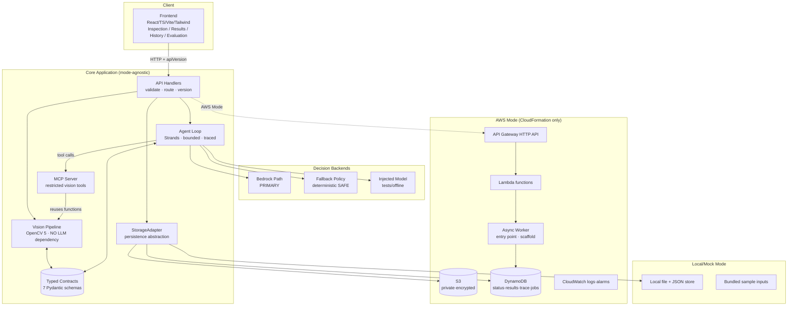
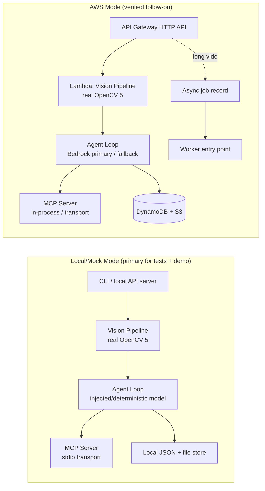
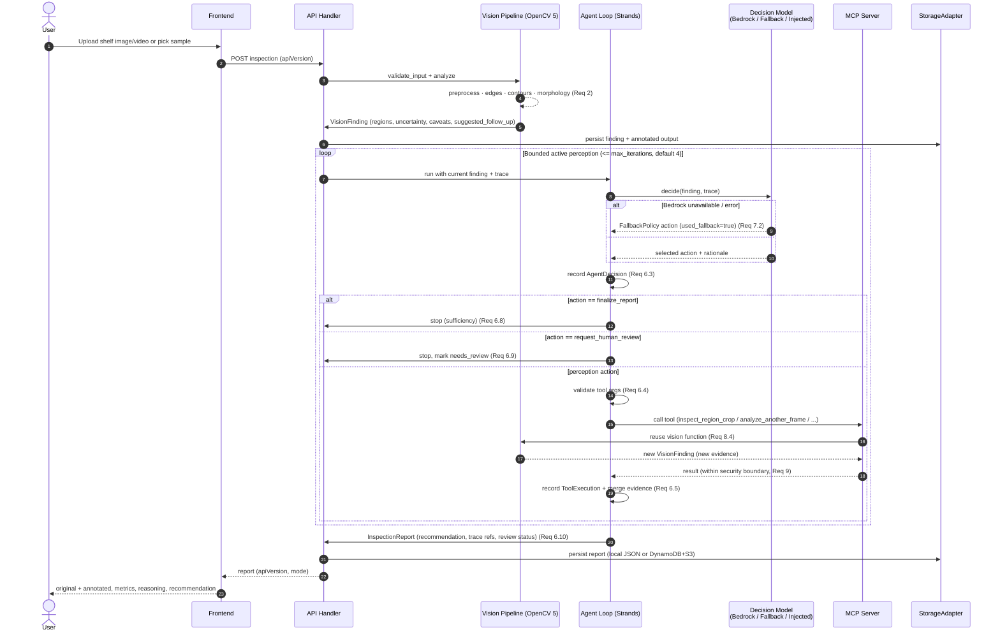

# Design Document

## Overview

ShelfSentry AI is a greenfield agentic retail shelf inspection system. It pairs substantive classical computer vision (OpenCV 5) with a bounded active-perception agent loop (Strands Agents) that reaches out through a restricted Model Context Protocol (MCP) server to gather more evidence before committing to a conclusion. The defining behavior is the **active-perception feedback loop**: the vision pipeline produces structured, uncertainty-quantified findings; the agent reads that uncertainty and *causally* decides which follow-up perception action to take; each action produces new evidence that feeds the next decision, until the agent finalizes an evidence-backed report.

The system is built **local/mock first**. The full pipeline (real OpenCV 5 analysis, real agent loop, real MCP tools) runs offline without AWS credentials, using an injected or deterministic decision model. This is the primary mode for tests and the demo (Req 15). AWS Mode is a **verified follow-on**: the same code paths run against deployed infrastructure provisioned exclusively through CloudFormation (Req 18.1), with Amazon Bedrock as the **primary** agent decision path and a deterministic policy as a **thin safe fallback** (Req 7).

Design priorities, in order:

1. **Honesty and safety** (Req 27): never fabricate metrics, never silently delete data, never embed secrets, always attach visual caveats to empty-region claims.
2. **Causal, bounded agency** (Req 6, 23): findings demonstrably drive actions; iteration is capped and every decision is traced.
3. **Mode parity with fail-loud configuration** (Req 15, 16, 17): the same logic runs in both modes; misconfiguration fails at startup rather than silently degrading.
4. **Reusable, typed contracts** (Req 10): components exchange seven validated, versioned schemas.

### Technology Choices

| Concern | Choice | Rationale / Requirement |
| --- | --- | --- |
| Vision | OpenCV 5 (Python `cv2`), NumPy | Substantive classical CV; version verified at build time (Req 2.1, 26.4) |
| Agent | Strands Agents SDK | Required integration (Req 6, 16.2) |
| Decision model | Amazon Bedrock (primary), deterministic policy (fallback), injected model (tests) | Req 7.1–7.4 |
| Tool exposure | Python MCP SDK, Strands-compatible transport | Req 8.1 |
| Data contracts | Pydantic v2 models | Typed, validated, JSON-serializable, versioned (Req 10) |
| Persistence | `StorageAdapter` abstraction → local JSON/file store or DynamoDB + S3 | Req 15.4, 16.1, 18 |
| API | AWS Lambda + API Gateway HTTP API | Req 19.1 |
| IaC | CloudFormation `template.yaml` only | Req 18.1 (no CDK/Terraform) |
| Frontend | React + TypeScript + Vite + Tailwind | Req 11–14 |

> **OpenCV version note:** OpenCV 5 modernizes the DNN engine, bindings, and core, while the classical primitives this system depends on (Canny edges, `findContours`, morphological `morphologyEx`, thresholding, color-space conversion) remain first-class. Because the exact 5.x point release and its API surface can shift, the system **verifies `cv2.__version__` at build/startup time** and records the exact version in every `VisionFinding` (Req 2.1). The design never assumes an API exists without that runtime check.

## Architecture

### High-Level Components



**Separation of concerns.** The **Vision Pipeline has no dependency on the LLM or agent** — it is a pure CV module that takes bytes and configuration and returns a `VisionFinding`. The **MCP Server reuses vision functions** rather than reimplementing them (Req 8.4). The **Agent Loop depends only on typed contracts and a `DecisionModel` interface**, never on a concrete cloud SDK directly. The **StorageAdapter** is the single seam between mode-agnostic logic and mode-specific persistence. This layering is what lets the identical pipeline run in both modes (Req 15.1, 16.4).

### Two-Mode Deployment Topology



A single `Config_Switch` (`SHELFSENTRY_MODE=local|aws`) selects the topology (Req 17.1). The switch is resolved once at startup; AWS Mode validates required configuration and **fails startup loudly** if it is missing (Req 17.2), and never substitutes local/mock results while AWS Mode is selected (Req 16.4, 17.3).

### The Active-Perception Feedback Loop (central differentiator)

The loop is the product. The vision pipeline is deliberately uncertain — it labels results as estimates and attaches caveats (Req 2.5, 4.7) — and that honest uncertainty is exactly what the agent acts on:

1. Vision produces a `VisionFinding` with per-region `Uncertainty_Value` and a `suggested_follow_up` (Req 4.6).
2. The agent reads findings + accumulated `Decision_Trace` and selects one of five actions.
3. The chosen action runs as an MCP tool call, which **reuses vision functions** to produce *new* evidence (a region crop re-analysis, another frame, a frame comparison, annotated evidence).
4. New evidence is appended to the trace and fed into the next iteration (Req 6.5).
5. The loop terminates on sufficiency, conflict (human review), or the iteration cap, producing an `InspectionReport` that references the supporting trace (Req 6.7–6.10).

## Components and Interfaces

### 1. Vision Pipeline (OpenCV 5, no LLM dependency)

**Responsibility:** Validate input, preprocess, run substantive OpenCV 5 analysis, score candidate regions, annotate, and sample video frames. Pure functions over bytes + config; deterministic for a given input and config (Req 5.1).

**Module layout**

```
vision/
  validate.py       # content-type, size, decodability (Req 1)
  preprocess.py     # decode, grayscale, blur, normalize
  analyze.py        # shelf-region / edge / contour / morphology (Req 2)
  scoring.py        # heuristic score + empty-space ratio + uncertainty (Req 4)
  annotate.py       # draw regions onto Annotated_Output (Req 2.4, 5.3)
  video.py          # frame sampling (Req 3)
  version.py        # verify cv2.__version__ at build/startup (Req 2.1)
```

**Which OpenCV 5 operations do substantive work**

| Stage | OpenCV 5 operation(s) | Role in detecting empty regions |
| --- | --- | --- |
| Decode / validate | `cv2.imdecode`, `cv2.VideoCapture` | Confirms the bytes are a decodable image/video (Req 1.1, 1.2) |
| Preprocess | `cv2.cvtColor` (BGR→gray/HSV), `cv2.GaussianBlur`, `cv2.equalizeHist`/CLAHE | Normalizes lighting/shadow before measurement |
| Shelf-region analysis | `cv2.Sobel`/gradient + horizontal projection, optional `cv2.HoughLinesP` | Locates shelf bands to constrain where product should be |
| Edge analysis | `cv2.Canny` | Low edge density inside a shelf band suggests empty space |
| Contour analysis | `cv2.findContours`, `cv2.boundingRect`, `cv2.contourArea` | Delineates product blobs vs gaps → candidate bounding boxes |
| Morphology | `cv2.morphologyEx` (open/close/dilate/erode) | Cleans noise, consolidates gap regions so measurement is stable |
| Thresholding | `cv2.threshold` (Otsu) / `cv2.adaptiveThreshold` | Separates filled vs empty under uneven lighting |

`Empty_Space_Ratio` is computed per candidate region as the fraction of low-edge-density / below-threshold area within the region's bounding box. It is a **measured visual metric**, reported as an estimate, and kept **distinct from any calibrated probability** (Req 2.6, 4.2). The `Heuristic_Score` is a rule-derived combination of empty-space ratio, region size, and edge sparsity — explicitly **not** a probability.

**Determinism (Req 5).** No randomized operations; fixed kernel sizes and thresholds from config; contours sorted by a stable key (top-left `(y, x)` then area) before emission so bounding-box coordinates are byte-for-byte reproducible across runs. All boxes use one documented coordinate system: integer pixels, origin top-left, `(x, y, w, h)` relative to the analyzed input's dimensions (Req 5.2). Annotations are drawn at exactly those coordinates (Req 5.3).

**Video sampling (Req 3).** Uniform sampling: given frame count `N` and configured max `M`, select `M` indices evenly across `[0, N)` (documented strategy, Req 3.4). Each sampled frame gets a stable `frame_id` (`"frame_{index:06d}"`) and is analyzed with the **same** image analysis path (Req 3.2, 3.3).

**Public interface**

```python
def validate_input(data: bytes, content_type: str, cfg: VisionConfig) -> None: ...  # raises ValidationError
def analyze_image(data: bytes, cfg: VisionConfig) -> VisionFinding: ...
def analyze_video(data: bytes, cfg: VisionConfig) -> list[VisionFinding]: ...
def inspect_region(data: bytes, box: BoundingBox, cfg: VisionConfig) -> VisionFinding: ...
def compare_frames(a: bytes, b: bytes, cfg: VisionConfig) -> VisionFinding: ...
def render_annotation(data: bytes, finding: VisionFinding) -> bytes: ...  # Annotated_Output
def opencv_version() -> str: ...  # verified, recorded in each finding
```

### 2. Agent Loop (Strands, bounded active perception)

**Responsibility:** Given a `VisionFinding`, iteratively select perception actions, call MCP tools, record a trace, and produce an `InspectionReport` within a bounded iteration count (Req 6).

**Action set (fixed, Req 6.1):** `{inspect_crop, analyze_another_frame, request_better_image, request_human_review, finalize_report}`.

**Decision model abstraction (Req 7).** The loop depends on an interface, not a vendor:

```python
class DecisionModel(Protocol):
    def decide(self, finding: VisionFinding, trace: list[TraceEntry], cfg: AgentConfig) -> AgentDecision: ...

class BedrockDecisionModel:   # PRIMARY in AWS Mode (Req 7.1)
class FallbackPolicy:         # thin deterministic SAFE fallback (Req 7.2, 7.4)
class InjectedDecisionModel:  # offline/causality tests (Req 7.3)
```

- **Bedrock primary:** used while AWS Mode is active and Bedrock is reachable (Req 7.1). The agent sends the structured finding + trace and parses a validated action selection.
- **Fallback policy:** if Bedrock is unavailable or errors, the loop switches to a **deterministic** rule policy and records `used_fallback=true` with a reason on the `AgentDecision` (Req 7.2, 7.4). The policy is pure: same finding + trace → same action.
- **Injected model:** in Local/Mock Mode, a test-supplied model drives decisions so causality tests run without AWS creds (Req 7.3).

**Deterministic fallback policy (reference logic):**

| Condition on finding/trace | Selected action |
| --- | --- |
| High uncertainty on a specific region, not yet cropped | `inspect_crop` (that region) |
| Ambiguous finding, unsampled frames remain (video) | `analyze_another_frame` |
| Image quality poor (low contrast / blur flag) | `request_better_image` |
| Conflicting evidence across trace entries | `request_human_review` |
| Evidence sufficient OR iteration cap reached | `finalize_report` |

**Loop control (Req 6.6–6.9).**

```python
def run_agent_loop(finding: VisionFinding, model: DecisionModel, tools: MCPToolClient,
                   cfg: AgentConfig) -> InspectionReport:
    trace: list[TraceEntry] = []
    iteration = 0
    while iteration < cfg.max_iterations:          # default 4, configurable (Req 6.6)
        decision = model.decide(finding, trace, cfg)   # Bedrock / fallback / injected
        trace.append(decision)                          # Agent_Decision (Req 6.3)
        if decision.action == "finalize_report":
            break
        if decision.action == "request_human_review":  # (Req 6.9)
            return finalize(finding, trace, human_review=True)
        validate_tool_args(decision)                    # reject invalid (Req 6.4)
        result = tools.call(decision.action, decision.args)
        trace.append(ToolExecution(...))                # (Req 6.5)
        finding = merge_evidence(finding, result)       # feed next iteration
        iteration += 1
    return finalize(finding, trace, human_review=False) # cap or sufficiency (Req 6.7, 6.8, 6.10)
```

**Causality (Req 6.2, 23.1).** Because `decide` is a pure function of the finding (plus trace), two different findings can and do produce different actions; tests assert this directly. `inspect_crop` consumes the region identified by the preceding finding (Req 23.2). Tool-arg validation happens before any execution (Req 6.4). The final report references the trace entries that support the recommendation (Req 6.10).

### 3. MCP Server (restricted vision tools)

**Responsibility:** Expose a minimal, validated tool surface to the agent using a maintained Python MCP SDK over a Strands-compatible transport (Req 8.1). Tools **reuse** vision pipeline functions (Req 8.4).

**Tools (Req 8.2):**

| Tool | Wraps | Input (validated against schema) | Output |
| --- | --- | --- | --- |
| `analyze_shelf_image` | `analyze_image` | `inspection_id`, image reference | `VisionFinding` JSON |
| `inspect_region_crop` | `inspect_region` | `inspection_id`, `BoundingBox` | `VisionFinding` for the crop |
| `compare_shelf_frames` | `compare_frames` | `inspection_id`, two `frame_id`s | `VisionFinding` diff |
| `get_annotated_evidence` | `render_annotation` | `inspection_id`, `finding_id` | reference to `Annotated_Output` |

**Argument validation (Req 8.3).** Every invocation is validated against the tool's JSON schema; invalid arguments are rejected before execution with a structured error.

**Security boundary (Req 9).** Tools operate only on inspection-scoped media resolved through the `StorageAdapter` by id. The server enforces four hard limits:

1. **No unrestricted AWS credentials** exposed through any tool (Req 9.1) — media is fetched by the server using its own scoped adapter, not by passing credentials to the agent.
2. **No unrestricted filesystem access** (Req 9.2) — inputs are referenced by inspection id; no tool accepts an arbitrary path.
3. **No arbitrary URL fetches** (Req 9.3) — no tool takes a URL.
4. **No shell execution** (Req 9.4) — tools call Python vision functions only.

### 4. Data Layer (typed contracts + persistence abstraction)

**Responsibility:** Define the seven typed schemas, validate at boundaries, serialize consistently, and persist in either mode (Req 10).

```python
class StorageAdapter(Protocol):
    def put_media(self, inspection_id: str, data: bytes, kind: str) -> str: ...
    def get_media(self, ref: str) -> bytes: ...
    def save_report(self, report: InspectionReport) -> None: ...
    def get_report(self, inspection_id: str) -> InspectionReport | None: ...
    def list_reports(self, query: HistoryQuery) -> list[InspectionSummary]: ...
    def save_job(self, job: JobRecord) -> None: ...   # async path
    def get_job(self, job_id: str) -> JobRecord | None: ...

class LocalStorageAdapter(StorageAdapter):  # JSON + files on disk (Req 15.4)
class AwsStorageAdapter(StorageAdapter):     # S3 media + DynamoDB records (Req 16.1)
```

Boundary validation rejects malformed data with a field-identifying error (Req 10.2, 10.5). Serialization is canonical (sorted keys, stable formatting) so equivalent objects produce identical JSON (Req 10.3). Every API response carries an `apiVersion` (Req 10.4).

### 5. Frontend (React / TypeScript / Vite / Tailwind)

Four pages, a typed API client, and **mode-aware** behavior (the client reads a `mode` field from responses and labels demo vs real data). All pages target **WCAG 2.1 Level AA** (Req 11.6, 12.5, 13.5, 14.6): semantic landmarks, labeled controls, keyboard operability, visible focus, and non-color status cues.

| Page | Purpose | Key requirements |
| --- | --- | --- |
| Inspection | Upload image/video or pick a bundled sample; client-side type/size validation; progress; error + empty states | Req 11.1–11.6 |
| Results | Original + annotated side-by-side with highlighted regions; per-region metric + uncertainty interpretation; agent initial finding, chosen action + rationale, tool results; final recommendation + human-review status | Req 12.1–12.5 |
| History | List with status + timestamp; search/filter; detail drill-in; empty state | Req 13.1–13.5 |
| Evaluation | Measured test-set performance; FP/FN examples; decision correctness; latency; documented limitations; demo-vs-real distinction; **measured only, no fabricated metrics** | Req 14.1–14.6, 27.2 |

**API client:** thin typed wrapper; sends/receives the versioned contracts; surfaces structured validation errors to the UI; mirrors the client-side size/type checks the server enforces.

### 6. Infrastructure (CloudFormation only)

A single `template.yaml` (Req 18.1) provisions:

| Resource | Configuration | Requirement |
| --- | --- | --- |
| S3 bucket | Private, SSE encryption, Block Public Access on, lifecycle/retention | Req 18.2, 20.3 |
| DynamoDB table(s) | Inspection status, results, `Decision_Trace`, **job-status** records; configurable names; deletion/retention policy | Req 18.4, 18.5, 19.4, 20.3 |
| Lambda functions | Explicit timeout + memory per function; vision + API + worker entry point | Req 19.1, 19.2 |
| API Gateway HTTP API | Inspection API routes | Req 19.1 |
| CloudWatch | Log groups with explicit retention; basic alarms | Req 19.3 |
| IAM roles | Least privilege per component | Req 20.1 |
| Async job path | DynamoDB job record + worker entry point (thin scaffold; heavy ECS/Fargate deferred) | Req 19.4, 19.5 |

**Presigned uploads (Req 18.3):** large media is uploaded directly to S3 via a presigned URL minted by a Lambda; the browser never receives AWS credentials. **No secrets** appear in the template, code, frontend, or VCS (Req 20.2). A teardown guide documents stack removal honoring deletion/retention policies (Req 21).

## Data Models

Seven typed contracts (Pydantic v2), validated at every boundary, versioned, canonically serialized (Req 10). All model responses carry `schema_version`; API envelopes carry `apiVersion`.

### InspectionRequest (Req 1, 11)
```python
class InspectionRequest(BaseModel):
    schema_version: str
    inspection_id: str
    media_kind: Literal["image", "video"]
    content_type: str                 # checked against accepted set (Req 1.5)
    size_bytes: int                    # checked against max (Req 1.6)
    media_ref: str                     # storage reference, not a path/URL
    config_overrides: dict | None = None
```

### VisionFinding (Req 2, 4, 5)
```python
class VisionFinding(BaseModel):
    schema_version: str
    finding_id: str
    inspection_id: str
    source: Literal["image", "video_frame", "crop", "frame_compare"]
    frame_id: str | None                      # present for video-derived (Req 4.4)
    opencv_version: str                       # exact version recorded (Req 2.1)
    candidate_regions: list[CandidateRegion]  # zero or more (Req 4.1)
    uncertainty_interpretations: dict[str, str]  # per-value meaning (Req 4.3)
    annotated_output_ref: str                 # evidence reference (Req 4.5)
    suggested_follow_up: AgentAction          # hint to the agent (Req 4.6)
    is_estimate: Literal[True] = True         # CV results are estimates (Req 2.5)
```

### CandidateRegion (Req 4, 5, 27)
```python
class CandidateRegion(BaseModel):
    region_id: str
    bounding_box: BoundingBox                 # (x, y, w, h) px, top-left origin (Req 5.2)
    empty_space_ratio: float | None           # measured metric (Req 4.2)
    alt_metric: dict | None                   # documented alternative if ratio N/A
    heuristic_score: float                    # rule-derived, NOT a probability (Req 2.6)
    uncertainty_value: float                  # interpreted via finding map (Req 4.2, 4.3)
    frame_id: str | None                      # (Req 4.4)
    visual_caveat: str                        # shadow/occlusion/dividers/quality (Req 4.7, 27.4)
```

**Uncertainty interpretation (Req 4.3):** `uncertainty_value` is documented per finding (e.g., "0 = low measurement confidence, 1 = high"); it is a confidence measure over the *measurement*, never a calibrated out-of-stock probability. **Heuristic-score vs probability (Req 2.6):** `heuristic_score` is an ordinal rule output used for ranking regions, explicitly separated from any probability. **Visual caveat (Req 4.7, 27.4):** every region that appears empty carries a human-readable caveat; the system never asserts out-of-stock as proven.

### AgentDecision (Req 6, 7)
```python
class AgentDecision(BaseModel):
    schema_version: str
    decision_id: str
    iteration: int
    action: AgentAction                       # one of the five (Req 6.1)
    rationale: str                            # (Req 6.3)
    args: dict                                # validated before use (Req 6.4)
    decided_by: Literal["bedrock", "fallback", "injected"]
    used_fallback: bool                       # true when fallback engaged (Req 7.2)
    fallback_reason: str | None
```

### ToolExecution (Req 6)
```python
class ToolExecution(BaseModel):
    schema_version: str
    execution_id: str
    iteration: int
    tool: Literal["analyze_shelf_image", "inspect_region_crop",
                  "compare_shelf_frames", "get_annotated_evidence"]
    args: dict
    result_ref: str                           # reference to resulting finding/evidence
    status: Literal["ok", "rejected", "error"]
    error: str | None
```

### InspectionReport (Req 6, 12, 16)
```python
class InspectionReport(BaseModel):
    schema_version: str
    inspection_id: str
    mode: Literal["local", "aws"]             # mode-aware frontend (Req 17)
    final_recommendation: str
    requires_human_review: bool               # (Req 6.9)
    initial_finding_id: str
    decision_trace: list[TraceEntry]          # ordered decisions + executions (Req 6.10)
    supporting_evidence_refs: list[str]       # trace entries backing the recommendation
    created_at: str
    status: Literal["complete", "failed", "needs_review"]
```
`TraceEntry` is a discriminated union of `AgentDecision | ToolExecution` ordered by iteration (the `Decision_Trace`).

### EvaluationResult (Req 14, 25, 27)
```python
class EvaluationResult(BaseModel):
    schema_version: str
    eval_run_id: str
    is_demo: bool                             # distinguish demo vs real (Req 14.5)
    sample_count: int
    false_positives: list[EvalExample]        # measured (Req 25.2)
    false_negatives: list[EvalExample]
    agent_decision_correctness: float         # measured only (Req 14.4, 27.2)
    latency_ms_p50: float
    latency_ms_p95: float
    documented_limitations: list[str]         # (Req 25.3)
    measured_only: Literal[True] = True        # never fabricated (Req 25.4, 27.2)
```

## Error Handling

| Condition | Handling | Requirement |
| --- | --- | --- |
| Unsupported content type / oversize / empty file | Reject at validation with a structured error naming the specific condition | Req 1.3, 1.5, 1.6 |
| Corrupt / undecodable image or video | Reject with corrupt-or-invalid error; no downstream analysis | Req 1.4 |
| Schema validation failure at a boundary | Structured error identifying the failing field | Req 10.2, 10.5 |
| Bedrock unavailable or returns error | Switch to deterministic `FallbackPolicy`; record `used_fallback=true` + reason; continue (no silent failure) | Req 7.2 |
| Invalid tool arguments (agent or MCP) | Reject before execution; record `ToolExecution.status="rejected"` | Req 6.4, 8.3 |
| AWS operation failure in AWS Mode | Apply configured retry/backoff; surface a **failed** status when retries exhausted | Req 16.3 |
| Missing S3 object | Return a structured not-found error; mark affected step failed | Req 24.2 |
| Failed async job | Record failure status on the DynamoDB job record; pollable | Req 19.5, 24.2 |
| Mode misconfiguration (AWS Mode, missing config) | **Fail startup loudly** with a message naming the missing configuration; never fall back to local results | Req 17.2, 17.3, 16.4 |
| Reaching iteration cap | Stop and finalize a report (not an error) | Req 6.7 |

All errors are honest: the system reports a feature/test/deployment as working only after verification (Req 27.1) and never fabricates values in any output (Req 27.2).

## Correctness Properties

*A property is a characteristic or behavior that should hold true across all valid executions of a system — a formal statement about what the system should do. Properties bridge human-readable specifications and machine-verifiable correctness guarantees.*

### Property 1: Bad inputs are always rejected with the matching condition

For any input that is empty, non-decodable, of an unsupported content type, or over the configured size limit, the Vision_Pipeline rejects the Inspection_Request and returns a validation error identifying that specific condition.

**Validates: Requirements 1.3, 1.4, 1.5, 1.6**

### Property 2: Valid inputs are accepted

For any decodable image or video whose content type is in the accepted set and whose size is within the configured maximum, the Vision_Pipeline accepts the Inspection_Request for analysis.

**Validates: Requirements 1.7**

### Property 3: Every finding records the exact OpenCV version

For any analyzed input, the produced Vision_Finding records the exact runtime OpenCV version used for analysis.

**Validates: Requirements 2.1**

### Property 4: All vision results are labeled as estimates

For any Vision_Finding produced by the pipeline, the finding labels its classical computer vision results as estimates.

**Validates: Requirements 2.5**

### Property 5: Every candidate region carries required, well-typed fields

For any Candidate_Region produced, the region contains a bounding box, a measured Empty_Space_Ratio or a documented alternative metric, a Heuristic_Score kept distinct from any calibrated probability, and an Uncertainty_Value.

**Validates: Requirements 2.6, 4.2**

### Property 6: Every uncertainty value has a documented interpretation

For any Vision_Finding, every Uncertainty_Value in the finding has a corresponding documented interpretation.

**Validates: Requirements 4.3**

### Property 7: Empty-looking regions always carry a visual caveat

For any Candidate_Region that appears empty, the region includes a documented visual caveat covering shadow, occlusion, dividers, or image quality, and the system never asserts an out-of-stock condition as proven.

**Validates: Requirements 4.7, 27.4**

### Property 8: Annotation coordinates are reproducible

For any input analyzed more than once with the same configuration, the Vision_Pipeline produces identical bounding box coordinates for each Candidate_Region across runs.

**Validates: Requirements 5.1**

### Property 9: Annotations match recorded bounding boxes

For any Vision_Finding, the coordinates of the drawn annotations in the Annotated_Output match the bounding boxes recorded in the finding.

**Validates: Requirements 5.3**

### Property 10: Video sampling stays within the configured limit

For any video and configured maximum frame count M, the number of sampled frames is at most M, with each sampled frame analyzed by the same image analysis path.

**Validates: Requirements 3.1, 3.3, 3.4**

### Property 11: Sampled frames have unique identifiers

For any set of frames sampled from a video, every sampled frame has a unique frame identifier.

**Validates: Requirements 3.2**

### Property 12: Findings causally influence the selected action

For any two differing Vision_Finding inputs, the Agent_Loop is capable of selecting different next actions such that the findings causally determine the selected action.

**Validates: Requirements 6.2**

### Property 13: Invalid tool arguments are rejected before execution

For any tool invocation with arguments that fail the tool schema, the invocation is rejected before the tool executes and no tool side effect occurs.

**Validates: Requirements 6.4, 8.3**

### Property 14: Iteration count is bounded

For any Agent_Loop run, the number of iterations never exceeds the configured maximum, and reaching the maximum produces an Inspection_Report.

**Validates: Requirements 6.6, 6.7**

### Property 15: Reports reference existing trace evidence

For any produced Inspection_Report, every supporting evidence reference resolves to an entry that exists in that report's Decision_Trace.

**Validates: Requirements 6.10**

### Property 16: Model errors cause a recorded fallback

For any decision where the Bedrock_Path is unavailable or errors, the Agent_Loop uses the Fallback_Policy and records in the Agent_Decision that the Fallback_Policy was used.

**Validates: Requirements 7.2**

### Property 17: Fallback policy is deterministic

For any given Vision_Finding and Decision_Trace, the Fallback_Policy selects the same next action on every invocation.

**Validates: Requirements 7.4**

### Property 18: inspect_crop consumes the preceding finding's region

For any Agent_Loop iteration that selects inspect_crop, the crop arguments reference the Candidate_Region identified by the immediately preceding finding.

**Validates: Requirements 23.2**

### Property 19: Ambiguous findings gather more evidence

For any ambiguous Vision_Finding evaluated by the Fallback_Policy, the selected action is an evidence-gathering action rather than finalize_report.

**Validates: Requirements 23.3**

### Property 20: Conflicting evidence triggers human review

For any Decision_Trace containing conflicting evidence, the Agent_Loop selects request_human_review and marks the Inspection_Report as requiring human review.

**Validates: Requirements 23.4**

### Property 21: Equivalent typed objects serialize identically

For any typed contract object, serializing equivalent objects to JSON produces identical, canonical output.

**Validates: Requirements 10.3**

### Property 22: Every API response includes an API version

For any API response returned by the ShelfSentry_System, the response includes an API version identifier.

**Validates: Requirements 10.4**

### Property 23: Only measured metrics are reported

For any Evaluation_Result record or evaluation display, every reported metric traces to a measured value in recorded Evaluation_Result data, and no metric or confidence score is fabricated.

**Validates: Requirements 14.4, 25.4, 27.2**

## Active-Perception Sequence

The flow from OpenCV analysis to agent to MCP tool to new evidence to final decision (Req 26.2):



## Testing Strategy

Tests run primarily in Local/Mock Mode with real OpenCV 5 and an injected decision model, so the full suite runs offline without AWS credentials (Req 15). Property tests use at least 100 generated iterations each and are tagged `Feature: shelfsentry-ai-active-perception, Property {n}: {text}`. Unit tests cover specific examples and edge cases; integration tests cover infrastructure.

### Vision tests (Req 22)
- **Inputs** (Property 1, 2): valid, invalid, empty, and corrupt inputs across content types and sizes.
- **Adverse conditions** (Req 22.2; Properties 5, 7): varied lighting, shadows, dividers, occlusions, and multiple regions; assert region fields and visual caveats.
- **Video** (Req 22.3; Properties 10, 11): frame extraction count within limit and unique frame ids.
- **Reproducibility** (Req 22.4; Property 8): identical bounding boxes across repeated runs; annotation-vs-finding coordinate match (Property 9).
- **Version** (Property 3): finding records the exact runtime OpenCV version, verified at build time (Req 26.4).

### Agent causality and safety tests (Req 23)
- Different findings → different actions (Property 12 / Req 23.1).
- `inspect_crop` consumes the correct region (Property 18 / Req 23.2).
- Ambiguous finding → more evidence (Property 19 / Req 23.3).
- Conflicting evidence → `request_human_review` (Property 20 / Req 23.4).
- Max iterations respected (Property 14 / Req 23.5).
- Invalid tool arguments rejected (Property 13 / Req 23.6).
- Model error → fallback used and recorded (Property 16 / Req 23.7); fallback determinism (Property 17).
- Recorded Decision_Trace matches the tool calls made (Req 23.8): assert each `ToolExecution` corresponds to a preceding `AgentDecision` and the ordered trace equals the executed calls.

### Data-contract tests (Req 10)
- Canonical serialization equality (Property 21); boundary validation rejects malformed data with field-identifying errors; every response carries `apiVersion` (Property 22).

### API and infrastructure tests (Req 24)
- Request validation and rejection of invalid requests (Req 24.1).
- Missing S3 objects, failed jobs, and result retrieval (Req 24.2).
- CloudFormation template validation (Req 24.3) — `cfn-lint` / `validate-template` on `template.yaml`.
- IAM and storage security constraints (Req 24.4): S3 private + encrypted + public access blocked; least-privilege IAM; retention/deletion policies present.
- MCP security boundary (Req 9): tool schemas expose no path, URL, shell, or credential arguments.
- Mode fail-loud (Req 17.2, 17.3): AWS Mode with missing config fails startup with a naming message; no local substitution.

### Evaluation tests (Req 25)
- A small **reproducible labeled evaluation set** produces `EvaluationResult` records with measured false positives and false negatives (Req 25.1, 25.2).
- Documented limitations reported alongside results (Req 25.3).
- **Honest reporting** (Property 23 / Req 25.4, 27.2): displayed metrics trace to recorded values; no fabricated metrics or confidence scores; demo records distinguished from real records (Req 14.5).

### Test type notes
Infrastructure checks (CloudFormation validation, IAM/storage constraints) use integration/snapshot assertions, not property-based testing, because they are declarative configuration whose behavior does not vary with generated input. Mode-configuration and MCP-schema guarantees use example-based tests for the same reason.
